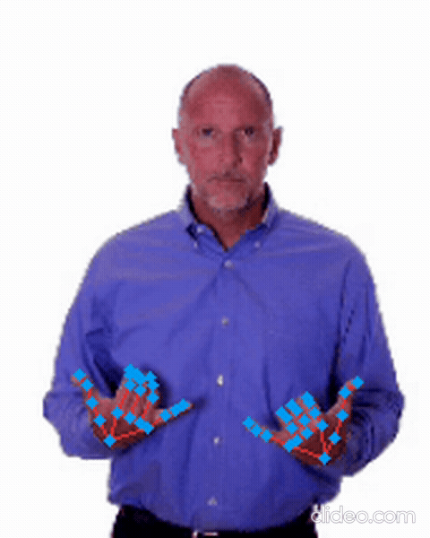
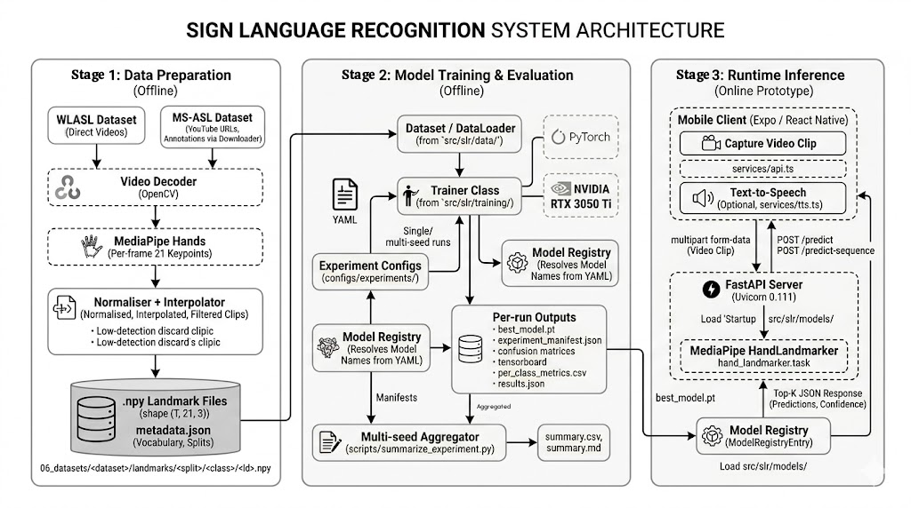

<h1 align="center">Word-Level ASL Recognition from Hand Landmarks</h1>

<p align="center">
  <strong>Bachelor's Thesis (Final Degree Project) · B.Sc. Computer Engineering · Universidad Francisco de Vitoria · 2026</strong><br/>
  Francisco Sandoval Hernández · Supervised by Moisés Martínez Muñoz
</p>

<p align="center">
  <a href="07_docs/FDP_Report_SandovalHernandezFrancisco.pdf"></a>
  <a href="07_docs/FDP_Presentation_SandovalHernandezFrancisco.pdf"></a>
</p>

<p align="center">
  
  
  
  
  
  
  
</p>

<p align="center">
  
  &nbsp;&nbsp;
  
  <br/>
  <sub>The sign <b>NO</b>: raw video (left) and the MediaPipe hand landmarks the model actually sees (right).</sub>
</p>

---

## TL;DR

Can a compact, skeleton-only description of hand movement carry enough information to recognise
isolated **American Sign Language (ASL)** words, without ever looking at raw pixels?

This project answers **yes, within a controlled vocabulary**. Each video frame is reduced to
**21 3D hand landmarks** (63 numbers instead of a 224×224×3 image, a **~2,389× reduction**), and a
**bidirectional GRU with temporal attention** (2.26 M parameters) classifies the resulting
sequence into a word gloss.

| | Dataset | Protocol | Top-1 | Top-5 |
| --- | --- | --- | ---: | ---: |
| Headline result | WLASL30 (30 words) | Stratified 5-fold CV | **63.85 ± 4.50 %** | **86.46 ± 2.04 %** |
| Cross-dataset | MS-ASL50 (50 words) | 3 seeds, no re-tuning | **70.20 ± 2.89 %** | **90.54 ± 0.89 %** |

Everything is trained on a single **4 GB laptop GPU**, tracked with per-run experiment manifests,
and wrapped in a **mobile app + FastAPI server** prototype that was tested with 15 users
(perceived utility 4.5/5, NPS +40).

> [!NOTE]
> This is a **research prototype for isolated word recognition**, not a production sign-language
> translator. The report is explicit about where the approach stops working (see
> [Limitations](#limitations)).

---

## Contents

- [Highlights](#highlights)
- [How it works](#how-it-works)
- [Results](#results)
- [The full report](#the-full-report)
- [Repository layout](#repository-layout)
- [Getting started](#getting-started)
- [Runtime prototype](#runtime-prototype)
- [Datasets](#datasets)
- [Limitations](#limitations)
- [Future work](#future-work)
- [Citation](#citation)

---

## Highlights

- **Landmarks instead of pixels.** Pose-based input discards background, lighting and skin tone
  at the source. That shrinks the model and, as a side effect, means the stored data cannot be used
  to reconstruct the signer's face or identity.
- **Controlled architecture study.** LSTM, GRU, GRU with geometric features, GRU+Attention and a
  Transformer were compared under the same split, preprocessing and hardware. Temporal attention
  added **+20.6 pp Top-1** over the plain GRU.
- **Several evaluation protocols.** Stratified 5-fold CV, multi-seed runs (seeds 42 / 123 / 2026)
  and a sequence-length sweep (32 / 64 / 96 frames). Test-Time Augmentation was deliberately
  excluded from all reported numbers.
- **Cross-dataset reproduction.** The same pipeline, retrained on MS-ASL with no
  architecture or hyperparameter changes, shows almost the same seed-to-seed stability
  (2.89 pp vs 2.94 pp).
- **Limits are measured.** Vocabulary scaling from 30 to 1,500 words shows *where* and
  *why* accuracy falls: the cause is too few clips per class, not a software bug.
- **Reproducibility.** YAML-driven runs, a tested Python package (`src/slr/`), and an
  `experiment_manifest.json` per run that records the git commit, config, hardware, runtime and metrics.
- **End to end.** An Expo / React Native app records a clip, a FastAPI server runs the same
  landmark pipeline and returns Top-K predictions with confidences, plus text-to-speech.

---

## How it works

<p align="center">
  
</p>

```text
ASL video clip
   │  OpenCV frame decoding
   ▼
MediaPipe Hands  ──►  21 landmarks × (x, y, z) per frame
   │  wrist-centring, scale normalisation, interpolation of missed frames,
   │  clips with < 30 % detection rate discarded
   ▼
Sequence tensor  (64 frames × 63 features)
   │  train-time augmentation: rotation, scale, translation, noise, mirroring
   ▼
Linear projection → 2-layer BiGRU (256) → Temporal Attention → MLP head
   ▼
Top-K word-gloss predictions + per-frame attention weights
```

**Training setup:** AdamW (lr 1e-3, wd 5e-4), cross-entropy with label smoothing 0.1, cosine
annealing, early stopping on validation Top-1 (patience 30, max 150 epochs), batch size 32.

The attention layer learns a weight per frame, so the model can focus on the frames that define the
sign and down-weight the preparation and recovery motion around it. The weights can also be
inspected afterwards to see which frames drove a prediction.

---

## Results

### Architecture selection (WLASL30, fixed split, 34 test clips)

| Model | Top-1 | Top-5 | Notes |
| --- | ---: | ---: | --- |
| BiLSTM | 41.18 % | 67.65 % | hidden 256, 2 layers |
| BiGRU | 38.24 % | 76.47 % | hidden 256, 2 layers |
| BiGRU + geometric features | 47.06 % | 79.41 % | bone vectors and joint angles |
| Transformer | 50.00 % | 73.53 % | 4 layers, 8 heads, d<sub>model</sub> = 256 |
| **BiGRU + Temporal Attention** | **58.82 %** | **91.18 %** | **selected, 2.26 M params** |

### Validation of the selected model

| Protocol | Top-1 | Top-5 | Macro-F1 | Balanced acc. |
| --- | ---: | ---: | ---: | ---: |
| WLASL30, stratified 5-fold CV | 63.85 ± 4.50 | 86.46 ± 2.04 | – | – |
| WLASL30, fixed split, 3 seeds | 58.82 ± 2.94 | 78.43 ± 4.49 | 54.88 ± 0.93 | 67.42 ± 0.76 |
| MS-ASL50, 3 seeds | 70.20 ± 2.89 | 90.54 ± 0.89 | 68.08 ± 3.44 | 70.22 ± 3.41 |

A 64-frame window was chosen over 32 and 96 frames. It had the highest mean Top-1 and by far the
most stable Macro-F1 across seeds (± 0.93 pp vs ± 8.27 / ± 6.33).

### Vocabulary scaling (WLASL)

| Classes | 30 | 100 | 300 | 500 | 700 | 900 | 1,000 | 1,200 | 1,500 |
| --- | ---: | ---: | ---: | ---: | ---: | ---: | ---: | ---: | ---: |
| **Top-1 (%)** | 58.8 | 44.7 | 28.6 | 23.7 | 19.6 | 12.5 | 11.2 | 10.6 | 9.8 |
| **Top-5 (%)** | 78.4 | 70.5 | 59.7 | 49.6 | 42.7 | 33.8 | 31.2 | 27.7 | 28.2 |

Accuracy declines gradually as the vocabulary grows. Over the same range, the average number of
clips per class falls from ~11 to ~4.6, and the gap between train and validation accuracy widens.
The main bottleneck is per-class data starvation. Rows above 30 classes are single-seed runs.

Stored metrics, plots, confusion matrices and manifests for every run are in
[`05_experiments/`](05_experiments/). Useful entry points:
[`final_assault/experiment_report.md`](05_experiments/final_assault/experiment_report.md),
[`sequence_length_sweep/sweep_summary.md`](05_experiments/sequence_length_sweep/sweep_summary.md),
[`msasl50_baseline/summary.md`](05_experiments/msasl50_baseline/summary.md) and
[`gap_bottleneck_analysis/`](05_experiments/gap_bottleneck_analysis/).

---

## The full report

📄 **[`07_docs/FDP_Report_SandovalHernandezFrancisco.pdf`](07_docs/FDP_Report_SandovalHernandezFrancisco.pdf)**:
the submitted thesis (98 pages, written in LaTeX). The LaTeX source is in
[`07_docs/PFG_latex/`](07_docs/PFG_latex/).

| Chapter | What it covers |
| --- | --- |
| 1. Introduction | Problem, research question and scope |
| 2. State of the Art | CNNs, pose estimation, RNN / LSTM / GRU, attention, Transformers, related SLR work |
| 3. Objectives | Hypothesis, six specific objectives and how each is validated |
| 4. Methodology & Work Plan | Hypothesis → experiment → learn loop, phases, constraints |
| 5. Technical Development | Three-stage architecture, requirements, the six datasets |
| 6. Experiments | Pivot from pixels to landmarks, architecture selection, sweeps, CV, cross-dataset, scaling, user study |
| 7. Ethics & Social Impact | Evaluation against Google's AI Principles (overall 7.6 / 10), privacy and bias |
| 9. Conclusions | Answer to the hypothesis, objective-by-objective assessment, next steps |
| Appendices | Extra figures, **user manual**, declaration of AI-tool usage |

Also in [`07_docs/`](07_docs/): the defence slides
([PDF](07_docs/FDP_Presentation_SandovalHernandezFrancisco.pdf)), a short
[demo video](07_docs/video_demo.mp4), the project proposal and the supervision meeting notes.

---

## Repository layout

```text
.
├── src/slr/                  # Reusable Python package
│   ├── data/                 #   landmark datasets, splits, padding, augmentation
│   ├── models/               #   gru_baseline, gru_attention, transformer + registry
│   ├── training/             #   trainer, losses, checkpointing, early stopping
│   ├── evaluation/           #   Top-K, Macro-F1, balanced accuracy, confusion matrices
│   └── tracking/             #   experiment manifests (git, hardware, config, metrics)
├── scripts/                  # CLI entry points: train, evaluate, extract landmarks, build subsets
├── configs/                  # YAML configs (base + per-experiment, multi-seed, sweeps)
├── tests/                    # Unit tests (no datasets required)
├── 01_notebooks/             # Exploratory notebooks: dataset prep, hand detection, word recognition
├── 02_models/                # Small YOLO base weights from the exploratory phase
├── 03_app/signtotext-expo/   # Expo / React Native mobile prototype
├── 04_server/                # FastAPI inference server
├── 05_experiments/           # Curated metrics, plots, manifests and reports
└── 07_docs/                  # Report (PDF + LaTeX), slides, proposal, meeting notes
```

> Datasets, downloaded videos and most checkpoints are **not** in Git (size and licensing).
> The curated results in `05_experiments/` can be inspected without them.

---

## Getting started

```bash
git clone https://github.com/fransandooo/TFG-SignLanguageToText.git
cd TFG-SignLanguageToText

python -m venv .venv && source .venv/bin/activate
pip install --upgrade pip
pip install -e ".[landmarks,dev]"   # core + MediaPipe/OpenCV + pytest

pytest                               # unit tests, no datasets needed
```

**Train** (needs the landmark datasets under `06_datasets/`, see [Datasets](#datasets)):

```bash
python scripts/train.py --config configs/experiments/wlasl30_baseline.yaml

# MS-ASL50 multi-seed runs
python scripts/train.py --config configs/experiments/msasl50_baseline/seed42.yaml
python scripts/train.py --config configs/experiments/msasl50_baseline/seed123.yaml
python scripts/train.py --config configs/experiments/msasl50_baseline/seed2026.yaml

# Sequence-length sweep: configs/experiments/sweep_maxframes/
```

Each run writes a self-contained folder in `05_experiments/` with the best checkpoint,
training history, `results.json`, per-class metrics, confusion matrices and
`experiment_manifest.json`.

**Evaluate** an existing checkpoint:

```bash
python scripts/evaluate.py \
  --checkpoint 05_experiments/final_assault/best_model_attention.pt \
  --metadata 06_datasets/wlasl/landmarks/wlasl30/metadata.json \
  --dataset-split 06_datasets/wlasl/landmarks/wlasl30/test \
  --output-dir 05_experiments/final_assault/eval_test \
  --architecture gru_attention
```

**Build MS-ASL50 and extract landmarks** (Appendix B of the report has the full procedure):

```bash
python scripts/build_msasl_subset.py \
  --audit-csv 06_datasets/MS-ASL/audit/audit_per_class.csv \
  --audit-videos-csv 06_datasets/MS-ASL/audit/audit_videos.csv \
  --output-dir 06_datasets/MS-ASL/subsets/msasl50 \
  --n-classes 50 --min-train 20 --min-val 3 --min-test 3

python scripts/extract_landmarks_msasl.py \
  --subset-metadata 06_datasets/MS-ASL/subsets/msasl50/metadata.json \
  --videos-dir 06_datasets/MS-ASL/videos \
  --output-dir 06_datasets/MS-ASL/subsets/msasl50/landmarks \
  --max-frames 64 --min-detection-rate 0.3 --skip-existing
```

---

## Runtime prototype

**FastAPI server** (port 8000):

```bash
pip install -r 04_server/requirements.txt
cd 04_server && python main.py
curl http://localhost:8000/health
```

| Endpoint | Description |
| --- | --- |
| `GET /health` | Server status and loaded model |
| `GET /models` | Available model registry entries |
| `GET /classes` | Class list of the selected model |
| `POST /predict` | Isolated-word prediction from an uploaded clip (Top-K + confidences) |
| `POST /predict-sequence` | Experimental continuous mode based on overlapping windows |

The server expects the checkpoint, `metadata.json` and MediaPipe `hand_landmarker.task` paths
declared in `04_server/main.py` to exist locally.

**Mobile app** (Expo / React Native):

```bash
cd 03_app/signtotext-expo
pnpm install
pnpm start
```

The app records or selects a short clip, sends it to the server, shows the Top-K predictions and
can read the Top-1 word aloud. On a physical device, point the server URL in the app config to
your computer's LAN address, not `localhost`.

---

## Datasets

| Dataset | Role in the project | Notes |
| --- | --- | --- |
| [WLASL](https://dxli94.github.io/WLASL/) | Main benchmark: WLASL30 and scaling subsets up to 1,500 words | 2,000 glosses, ~21k clips; ~69 % MediaPipe detection rate |
| [MS-ASL](https://www.microsoft.com/en-us/research/project/ms-asl/) | Independent cross-dataset validation (MS-ASL50) | Rebuilt from YouTube: 65.9 % of clips still available |
| EgoHands + Kaggle Hand | Exploratory YOLOv8n hand detector (~98 % mAP@0.5) | Phase that motivated the pivot to landmarks |
| Sign Language MNIST + ASL Alphabet | Exploratory static-letter classifiers | Superseded by word-level recognition |

Datasets are not redistributed. Expected local paths follow the configs, e.g.
`06_datasets/wlasl/landmarks/wlasl100_filtered30/` and `06_datasets/MS-ASL/subsets/msasl50/`.
Source notes: [`01_notebooks/dataset_preparation/dataset_references.md`](01_notebooks/dataset_preparation/dataset_references.md).

---

## Limitations

- **Isolated words only.** No continuous signing, grammar or sentence-level translation.
- **Hands only.** Facial expression and upper-body cues are not modelled, and MediaPipe misses
  hands under blur, occlusion or out-of-frame motion.
- **Small test sets.** On the WLASL30 fixed split, one error moves Top-1 by ~2.94 pp, which is why
  the 5-fold CV estimate is used as the headline number.
- **Dataset decay.** WLASL and MS-ASL depend on online videos that disappear over time, so the
  reconstructed subsets are not identical to the original releases.
- **Scaling.** Accuracy drops sharply at large vocabularies; runs above 30 classes are single-seed.
- **Prototype privacy.** The current server receives raw frames. Moving landmark extraction
  on-device would close this gap (see Chapter 7 of the report).

## Future work

1. **Technical:** continuous sentence-level recognition, and a smaller model for fully on-device inference.
2. **Scientific:** transfer to other sign languages (LSE, BSL) and a wider architecture comparison
   on larger data and hardware.
3. **Applied:** privacy-first edge deployment where only landmark vectors (or nothing at all) leave the phone.

---

## Citation

```bibtex
@thesis{sandoval2026aslLandmarks,
  author = {Sandoval Hern{\'a}ndez, Francisco},
  title  = {Word-Level American Sign Language Recognition from Hand Landmarks},
  type   = {Bachelor's thesis},
  school = {Universidad Francisco de Vitoria},
  year   = {2026},
  url    = {https://github.com/fransandooo/TFG-SignLanguageToText}
}
```

## Acknowledgements

Thanks to my supervisor **Moisés Martínez Muñoz** for his guidance throughout the project, and to
the authors of WLASL, MS-ASL and MediaPipe for making this kind of work possible.

<p align="center">
  <sub>Francisco Sandoval Hernández · <a href="https://www.linkedin.com/in/francisco-sandovalh">LinkedIn</a> · <a href="https://github.com/fransandooo">GitHub</a></sub>
</p>
